# Carnies
游乐园预约管理系统
亮点：WebSocket在线聊天、协同过滤算法、 ECharts话题分析、腾讯地图服务、预约核销流、游客交流与内容审核、分年龄票务管理；
角色：用户、管理员；

所有源码均本人开发，项目是前后端分离的，所有的项目都具备了完整的业务逻辑，不仅仅局限于基础的增删改查（CRUD）操作，系统亮点众多。

本文注重于计算机毕业设计选题指导，列出题目均有源码， 大家可以去【公众号】(毕业终点站)获取或者加我【qq】(2112698948)提意见(别忘记Star哟)。备注：git

声明：仅用于学习使用，请勿用于任何商业行为！

1.系统非商用，非开源，非无偿。

2.由本人开发，如需源码，请联系以下方式，qq:2112698948。

3.项目有很多，并未全部上传，如果未找到想要的，可直接咨询。

# 游乐园预约管理系统（游乐纪）

> B/S 前后端分离 · 用户网页前台 + 管理后台 · 管理员 / 普通用户两类角色
>
> Spring Boot 3.3.1 + Vue 2.6 + MyBatis-Plus + WebSocket + ECharts + 腾讯地图 JavaScript API

一套围绕游乐园预约搭建的系统：管理员维护游乐场资料、按儿童/成人/老人分别配置票价与库存、审核游客话题、核验入园；普通用户浏览乐园、挑选日期与游客下单、拿到六位核销码，还能在社区发话题、和客服在线聊。前台是「游乐纪」紫色系网页，后台是同一套视觉的管理工作台。

---

## 一、技术栈

| 层次 | 选型 |
| :--- | :--- |
| 架构 | B/S、MVC、前后端分离、用户网页前台 + 管理后台、管理员与普通用户角色区分 |
| 运行环境 | Windows |
| 开发工具 | IDEA、JDK 17、Maven、MySQL、Node.js |
| 后端 | Java、Spring Boot 3.3.1、Spring MVC、MyBatis-Plus、MySQL、JWT、WebSocket、Spring Mail、Apache POI |
| 前端 | Vue 2.6、Vue CLI、Element UI、Vue Router、Vuex、Axios、ECharts、Quill 富文本编辑器 |
| 地图与推荐 | 腾讯地图 JavaScript API、驾车路线规划、基于用户浏览行为的协同过滤推荐、余弦相似度计算 |

## 二、角色与功能范围

| 角色 | 主要使用范围 |
| :--- | :--- |
| 普通用户 | 注册登录、找回/修改密码、个人资料；按关键词、类型、城市筛选乐园并查看评分与地图位置；维护常用游客；按日期和游客预约下单；查看订单、游客明细与核销码，取消预约、评分评价；浏览/发布/收藏话题、评论回复点赞；查看推荐内容、公告、常见问题；在线聊天 |
| 管理员 | 用户查询维护、角色设置与数据导出；维护游乐场介绍、图片、地址、经纬度、类型并支持地图选址；按乐园和日期维护三类票价与库存；查询预约订单与游客明细、取消订单、输入核销码核验入园；维护游客身份与联系方式；话题分类与审核；轮播封面、公告、常见问题手册；数量概览与话题浏览人次图表；与用户在线沟通 |

## 三、功能亮点

- **预约核销流程**：从浏览乐园、选择日期和游客，到生成订单及六位核销码，再由管理员核验入园、用户评价，覆盖主要游园预约环节。
- **分年龄票务管理**：儿童、成人、老人分别设置票价与库存，下单时按游客年龄类别校验余票并扣减库存，同一订单可添加多名游客。
- **协同过滤推荐**：基于用户话题浏览记录构建行为数据，通过余弦相似度寻找兴趣相近的用户，为游客推荐相关话题。
- **腾讯地图服务**：后台支持地图选址，前台展示乐园位置并规划驾车路线，把线上查看信息衔接到线下出行。
- **WebSocket 在线聊天**：支持用户在线交流与历史消息查看，方便咨询游玩信息、沟通出行安排。
- **ECharts 话题分析**：按最近一周展示各话题浏览人次，支持柱状图与折线图切换、图表保存。
- **游客交流与内容审核**：话题发布、分类、收藏、评论回复、点赞，配合后台审核状态流转，给游玩经验分享留出交流空间。

---

## 四、界面展示

> 说明：源文档首图为双角色登录页，未提供独立的系统总览图，故「登录入口」单独成节，首图不充当总览横幅。全部截图均为桌面网页，按模块分区排布，一律全宽单图以保持文字清晰。

### 4.1 登录入口

「欢迎回来」登录卡放在摩天轮与城堡的紫色背景上，顶部可切换「管理员 / 用户」登录身份，下方依次是账号、密码、图形验证码，并提供忘记密码与立即注册入口。

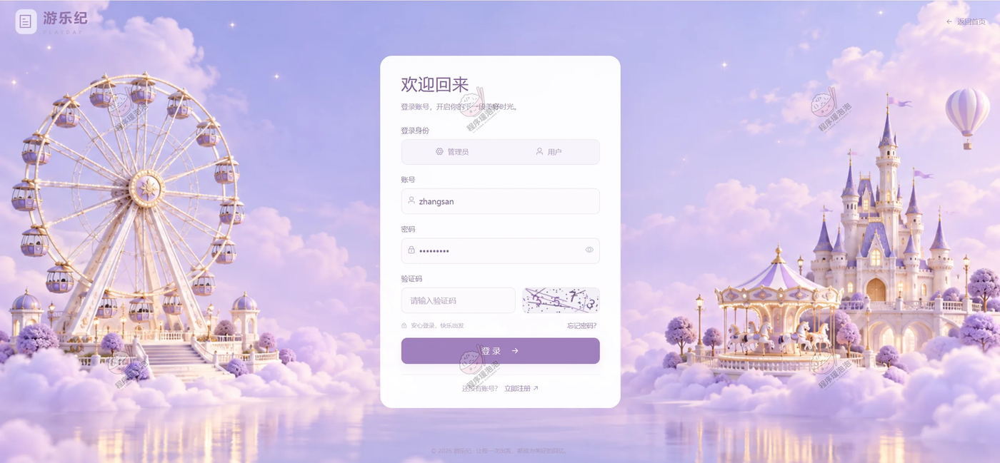

### 4.2 普通用户端（游乐纪前台）

**首页**
顶部导航含首页、探索乐园、游乐园社区、乐园公告、游园指南、游客信息、咨询客服，右侧是预约订单入口与账号菜单。首屏横幅「快乐，不必等周末」配「探索心动乐园」按钮；中间是乐园名称 / 游玩主题的查找栏；下方「选一个地方，尽情开心」展示侏罗纪公园、魔法森林冒险、冰雪奇缘王国三张精选卡片，卡片上带票价与交通游玩贴士。

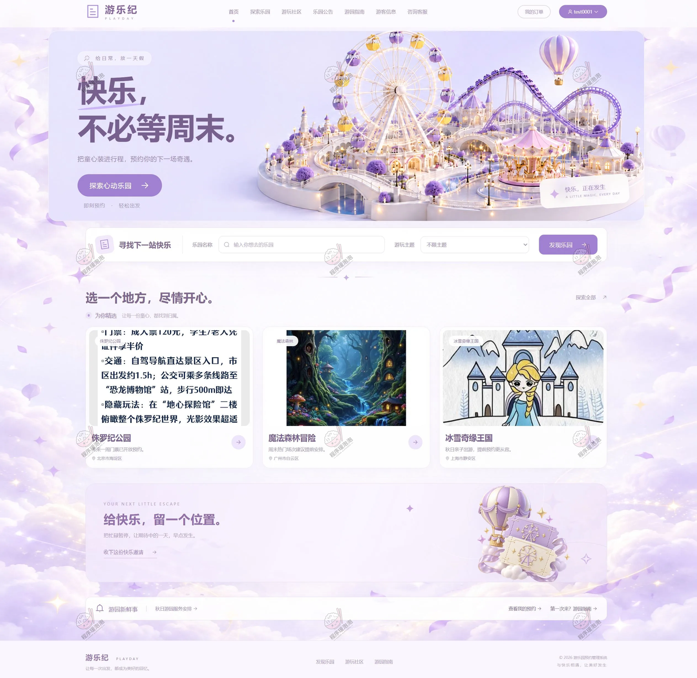

**探索乐园**
「下一站，想去哪儿玩？」提供关键词搜索，按游乐主题（全部、童话世界、未来科技城、海洋奇缘、恐龙探险谷、梦幻城堡园等）与所在城市（不限、北京、广州、上海、杭州…）筛选；结果区显示「为你发现 14 个快乐目的地」，支持综合推荐、人气优先、评分优先排序与卡片/列表视图切换。每张乐园卡带评分（4.5）、「69 人去过」和「查看乐园」入口，右上角可收藏。

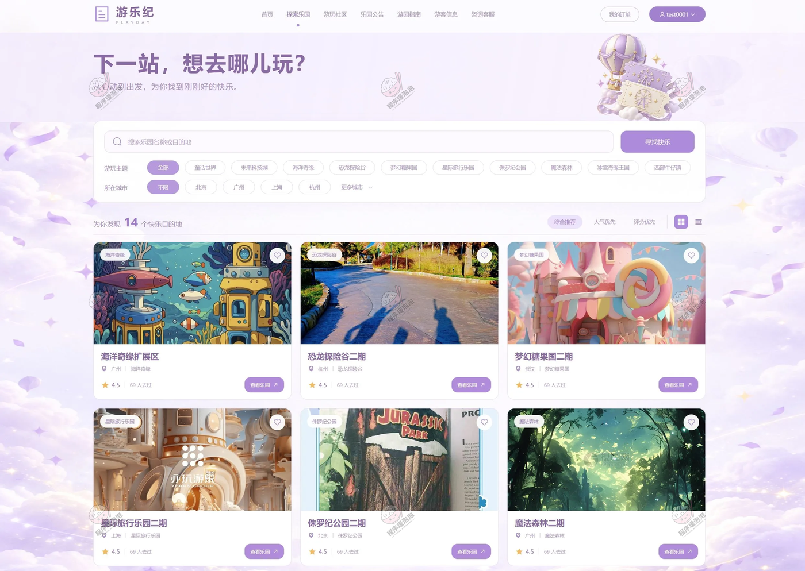

**乐园详情（基本信息与客流）**
以「童话世界第二园」为例，展示乐园主图、地址（上海市浦东新区星愿环路 1000 号）、游乐场类型「童话世界」、游客评价五星、游过总人次 70 次与最新通知；下方是「未来一周客流量」折线面积图，可切换客流量指标。

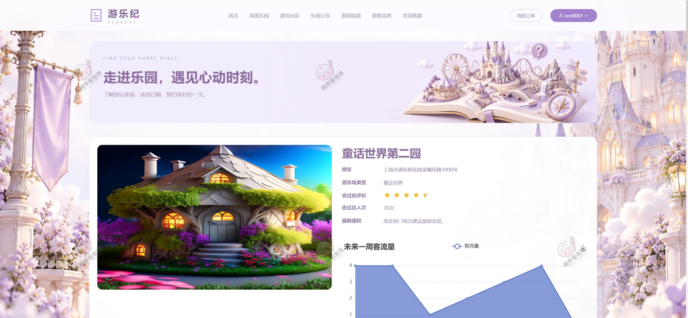

**乐园详情（可预约日期与票务）**
同一详情页下半部分：顶部是可预约日期日历（2026-10-19 起逐日排列，当前选中周一 19）；票务表格按日期与时段列出儿童票信息、成年票信息、老年票信息，每行显示对应余票数与价格，右侧「去购买」；再往下是「用户画像」，含去该游乐场的性别比例饼图与年龄阶段群体（儿童 / 成年 / 老年）漏斗图。

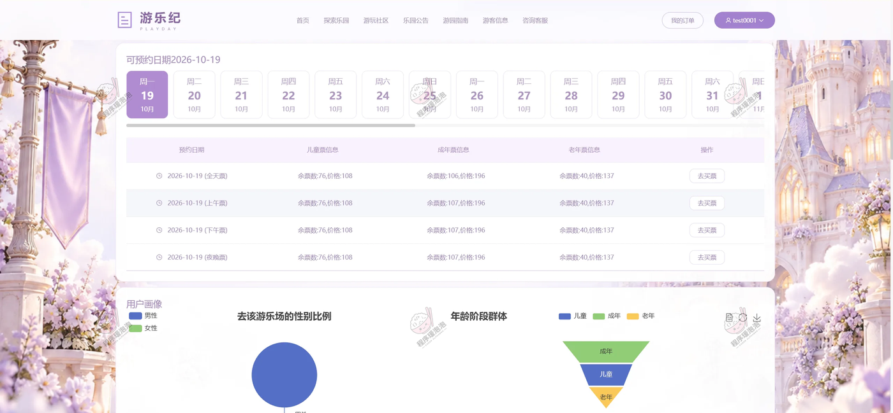

**乐园订单**
「把快乐，安排进日程」按全部、待使用、已使用、完成、系统取消、用户取消分状态查看。订单卡显示订单号（1FC7088BC9496ABA147A24078599A）、乐园名「童话世界第二园」、预约时间 2026-10-19 09:00:00、预约人数 1 人、地址，以及游客信息表（姓名、性别、电话、身份证、年龄类型、票价 ¥196），当前状态「待使用」。

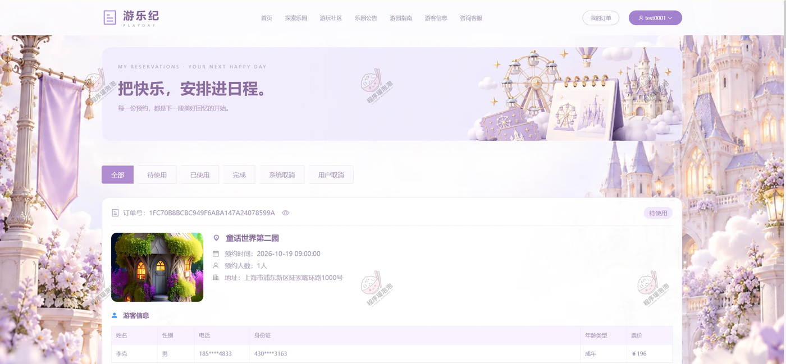

**乐园社区**
「把快乐，分享给同频的人」支持按话题、乐园体验、游玩攻略搜索，标签分推荐、最新、热门、精选，下挂全部话题、游乐园简介、热门活动、优惠信息、安全须知、游玩体验、设施介绍、交通指南等分类。右侧是「分享你的快乐」发布话题入口、我的话题、我的收藏，以及「大家都在聊」热榜；列表首条为管理员发布的「在线预约指南」，带时间与配图。

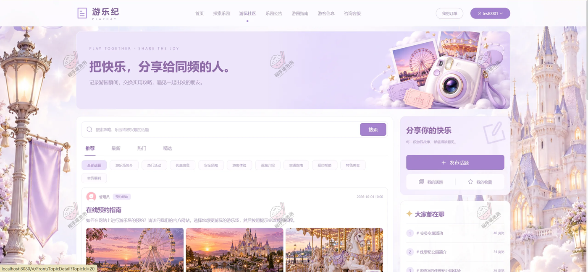

**乐园公告**
「乐园新鲜事，都在这里」按全部公告、乐园动态、活动报告、运营通知分类，共 10 条公告；列表以日期块展示「秋日游园服务安排」「预约功能使用说明」「亲子游园温馨提示」等，右侧「出发前的小提醒」汇总提前预约、关注开放时间、留意运营动态三条提示。

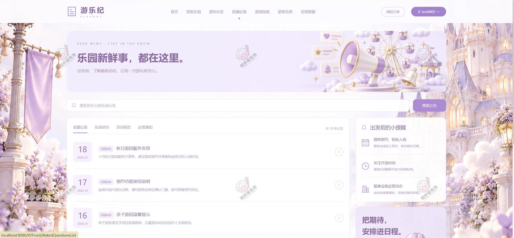

**游园指南**
顶部搜索「输入关键词，查找你关心的问题」，四个分类卡为预约与门票、入园与游玩、交通与服务、售后与帮助；左侧按问题分类（全部问题、交通、安全、预约、设施、其他、门票）筛选，中间「大家都在问」是可展开的 FAQ 列表（公共交通工具有哪些选择、游乐场内有哪些禁止行为、预约成功后会收到确认信息吗等），右侧「第一次来？」引导查看游园攻略。

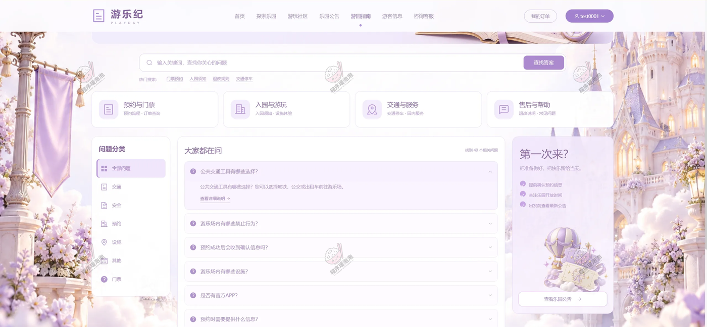

**资讯客服（在线聊天）**
「你的疑问，我们认真听」为三栏结构：左侧「我的会话」列出与管理员的对话并支持搜索，中间是与管理员的聊天窗口（含消息时间、双方气泡与底部输入框），右侧「也许你想了解」列出如何预约门票、如何查看订单、如何规划线路、是否带身份证入园等快捷问题。

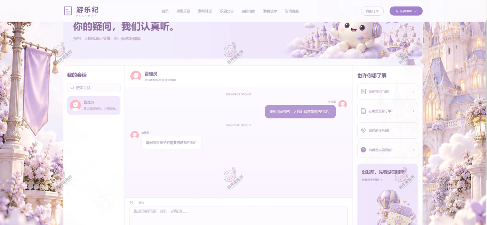

### 4.3 管理员端（游乐纪管理后台）

后台左侧菜单统一为：控制台、用户管理（用户信息）、话题管理（话题类型、话题信息、话题统计）、封面、游乐场类型、游乐场、门票、预约订单、系统通知、常见问题手册、用户聊天。

**话题列表**
支持按标题、话题类型查询与重置，可新增、批量删除。列表字段含标题、话题类型、封面、主图、浏览数、内容、是否推荐、审核状态；示例里「防诈骗提示」「安全须知提醒」等话题分别处于审核失败、待审核、审核通过状态，操作列提供查看、审核通过、审核不通过、取消推荐、删除。

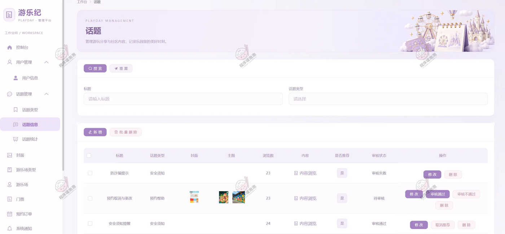

**话题统计**
「最近一周各话题浏览人次」以 ECharts 分组柱状图呈现，图例覆盖游乐场简介、热门活动、优惠信息、安全须知、游玩体验、设施介绍、交通指南、预约帮助、特色美食、会员福利十类；右上角提供柱状/折线切换与图表保存，纵轴刻度到 10。

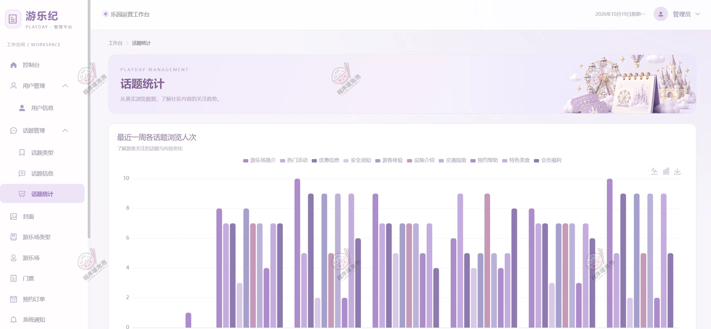

**游乐场**
按名称、省市区、详细地址、最新通知、类型组合查询，可新增与批量删除。列表展示名称、封面、内容、经度、纬度、省市区、详细地址；示例数据里侏罗纪公园（116.39713 / 39.91062，北京市海淀区）、魔法森林冒险（113.264 / 23.12911，广州市白云区）、冰雪奇缘王国（121.49912 / 31.24026，上海市静安区）均带经纬度，操作列提供查看、选择地址与删除。

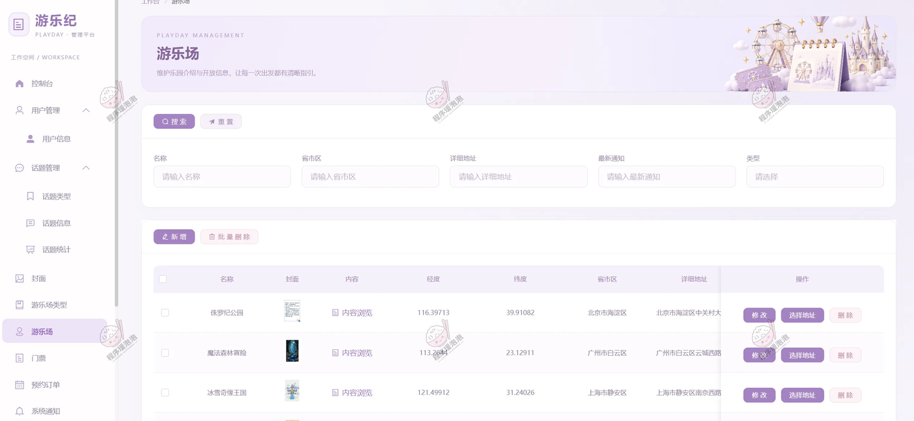

**门票**
按游乐场、门票类型、门票日期区间查询。列表按「名称 / 儿童票数 / 儿童票价 / 成年票数 / 成年票价 / 老人票数」分列，管理员可新增、查看、删除，用于按乐园和预约日期维护分年龄票价与库存。

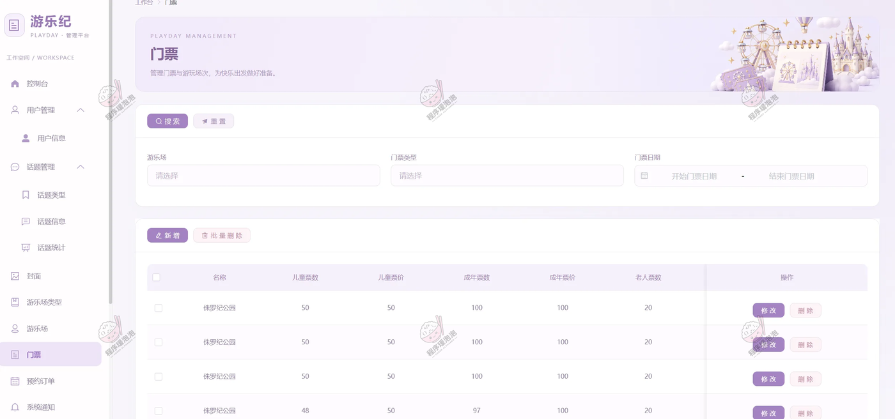

**预约订单**
支持按编号、游乐场、账号、预约状态、预约日期区间查询，并提供「核销」按钮。展示的是与用户端同一笔订单：订单号 1FC7088BC9496ABA147A24078599A、童话世界第二园、2026-10-19 09:00:00、1 人、上海市浦东新区星愿环路 1000 号，游客李燕（成年）票价 ¥196，总价 ¥196，状态「待使用」，右下角可系统取消。用户前台与后台看到的是同一份数据。

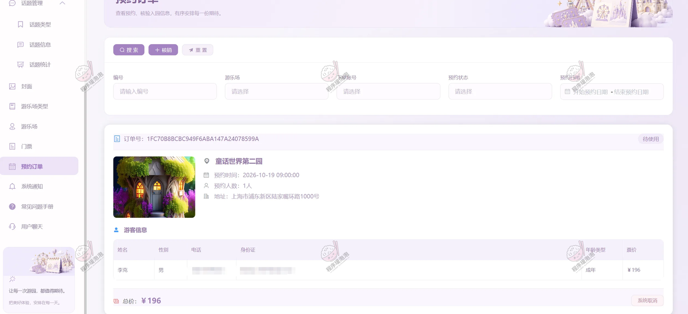

**用户聊天**
管理员侧聊天页：左侧会话列表（牛牛牛、小行星）带最后一条消息摘要与铃铛提醒，中间是与「小行星」的消息记录（「建议提前预约，入园时请携带预约凭证」2026-09-29 00:04:34，「请问周末亲子游需要提前预约吗？」2026-10-06 00:02:17），底部为输入框与清空、发送按钮。

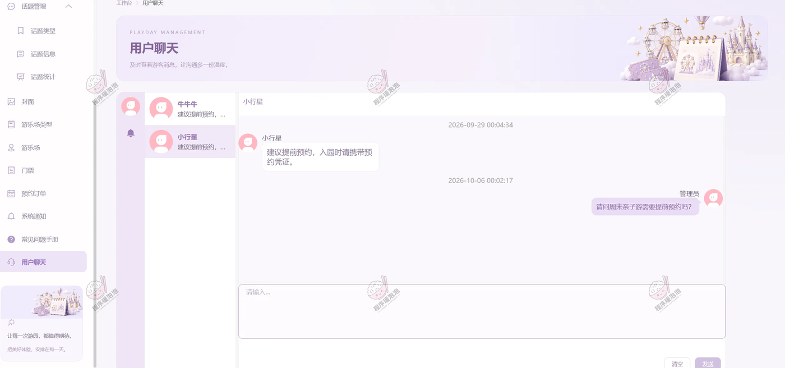

---

## 五、核心实现说明

**1. 预约与核销链路**
用户先在探索乐园按关键词、主题、城市筛选，进入详情确认地址、评分与未来一周客流，再选可预约日期、按年龄类别为每位游客选票提交订单；订单生成六位核销码，管理员在预约订单页输入核销码完成入园核验，之后用户可评分评价。订单以待使用、已使用、完成、系统取消、用户取消等状态标识处理阶段。

**2. 分年龄票务与库存扣减**
儿童、成人、老人三类票价与库存分开维护，门票按游乐场 + 预约日期 + 时段挂出余票数与价格；下单时按游客年龄类别校验对应余票并扣减库存，同一订单支持添加多名游客，订单与游客明细分别留档。

**3. 协同过滤话题推荐**
以用户的话题浏览记录构建行为数据，用余弦相似度找出兴趣相近的用户，再把相近用户看过的话题推荐给当前游客；前台社区里推荐、最新、热门、精选四类标签配合分类筛选，方便发现游玩分享内容。

**4. 腾讯地图选址与导航**
后台维护游乐场时保存经度、纬度与省市区详细地址，并提供地图选址；前台乐园详情展示位置，结合当前位置规划驾车路线，把线上查信息接到线下出行。

**5. WebSocket 在线沟通**
用户端资讯客服与后台用户聊天是同一套会话：消息带时间戳、区分双方气泡，支持查看历史消息、搜索会话与快捷问题引导，游客可咨询门票预约、入园凭证、交通线路等。

**6. 话题审核与内容维护**
游客发布的话题带分类、封面、主图、浏览数与是否推荐标记，后台按待审核、审核通过、审核失败流转，可取消推荐或删除；轮播封面、系统公告、常见问题手册同样由后台维护，前台对应乐园公告与游园指南页面。

**7. ECharts 话题分析与概览**
后台按最近一周统计各话题浏览人次，支持柱状图、折线图切换和图表保存；配合工作台数量概览，管理员能看到游客关注的内容变化，前台乐园详情也用图表展示未来一周客流量与用户画像（性别比例、年龄阶段）。

---

> 文档展示 16 张截图，需要了解更多，请联系我。
